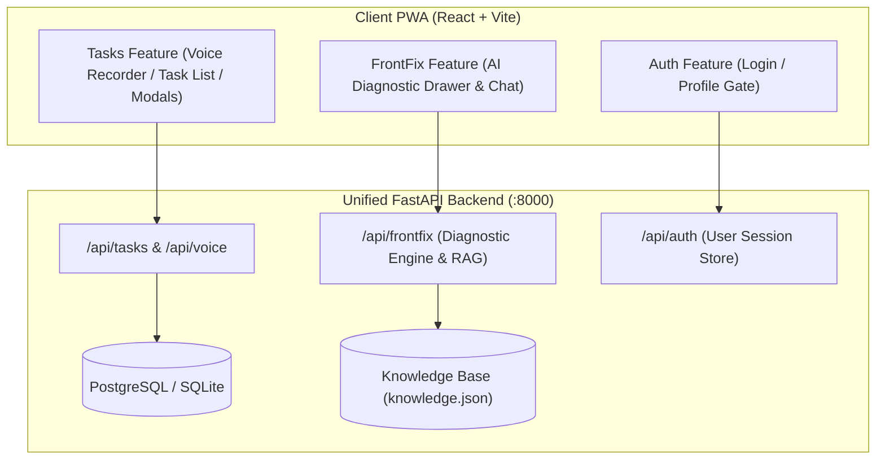

# 🎙️ VocaTask

VocaTask is a voice-first, multilingual task manager designed for fast capture on mobile and desktop. Users can speak naturally in English, Hindi, Punjabi, Hinglish, or other conversational languages, and the app turns that speech into a structured task with a title, due date, time, category, and priority.

It is built as a Progressive Web App (PWA) with a React + Vite frontend and a Python FastAPI backend. The goal is simple: turn spoken intent into a task that feels natural to review and save in under a minute.

> VocaTask is a practical prototype for voice-driven productivity workflows, with a focus on multilingual natural language understanding and mobile-first UX.

---

## ✨ Why this project exists

Most task apps still rely on manual typing. VocaTask aims to remove that friction by letting users say things like:

- "Kal shaam 6 baje study ke liye chemistry ka revision karna"
- "Tomorrow at 10 AM, finish the landing page mockup"
- "Pay electricity bill by Friday evening"
- "Gym at 7:00 PM, high priority"

The app interprets the spoken input, normalizes dates and times, classifies the task, and shows a review step before saving.

---

## 🌟 Core features

### 1. Voice-first task creation
- Browser-native microphone capture
- Live speech transcription
- Works in multilingual voice input
- Fast review flow before saving

### 2. Multilingual task interpretation
- Handles relative dates like today, tomorrow, next Monday, next week
- Understands colloquial time phrases like morning, evening, night
- Infers categories such as work, study, health, finance, and personal
- Suggests priority levels based on task context

### 3. Mobile-friendly PWA experience
- Installable on Android and iOS
- App-like experience without a native app store build
- Works across desktop, tablet, and phone browsers
- Optimized for microphone access and quick task entry on the go

### 4. AI-assisted confirmation flow
- Users can review the parsed task in a confirmation sheet
- Edit title, date, time, category, or priority before saving
- Confetti feedback on successful task creation

### 5. Backend data layer
- FastAPI API for task and voice processing
- PostgreSQL for persistent storage
- Environment-based configuration for provider keys and database settings

### 6. Security-conscious setup notes
- Sensitive credentials are expected to live in backend environment variables, not in the frontend
- The project includes warning notes around production authentication and user isolation as a realistic implementation constraint

---

## 🏗️ Architecture



---

## 🧩 Tech stack

### Frontend
- React 19
- Vite
- TypeScript
- Tailwind CSS
- PWA support via Vite plugin
- Canvas confetti for task success feedback

### Backend
- Python
- FastAPI
- PostgreSQL
- Pydantic for schema validation
- Provider integrations for AI services (Gemini, OpenAI, Groq, etc.)

---

## 🚀 Local development

### Prerequisites
- Node.js 20.19+ or 22.12+
- Python 3.10+
- PostgreSQL for local database use (or a tunnel to a remote DB)

### 1. Backend setup

```bash
cd backend
python -m venv venv

# Windows PowerShell
.\venv\Scripts\Activate.ps1

# macOS / Linux
source venv/bin/activate

pip install -r requirements.txt
```

Create a local environment file:

```bash
copy .env.example .env
# or
cp .env.example .env
```

Example configuration:

```env
GEMINI_API_KEY=your_gemini_api_key_here
OPENAI_API_KEY=your_openai_api_key_here
GROQ_API_KEY=your_groq_api_key_here
ELEVEN_LAB_API_KEY=sk_your_elevenlabs_secret_key_here

PGHOST=localhost
PGPORT=5433
PGDATABASE=vocatask
PGUSER=vocatask_user
PGPASSWORD=your_database_password
JWT_SECRET_KEY=replace-with-a-long-random-secret
```

Important:
- `backend/.env` is local-only and should never be committed
- Store real secrets in a secure environment manager or host secret store
- The backend checks env configuration in order from a custom path, local `.env`, repo root `.env`, user-level config, and system env vars

To check the task count and newest task in the configured PostgreSQL database (including AWS RDS), run this from the repository root in PowerShell:

```powershell
.\venv\Scripts\python.exe .\scripts\aws\check_rds_tasks.py
```

The script uses the same database configuration as the backend. Ensure `backend/.env` contains the correct database settings and that the RDS security group allows your current IP on port 5432.

Start the backend:

```bash
python run.py
```

The API will be available at:
- http://127.0.0.1:8000
- Swagger docs: http://127.0.0.1:8000/docs

### 2. Frontend setup

```bash
cd frontend
npm ci
npm run dev
```

For mobile testing with microphone permissions, you can run HTTPS mode:

```bash
npm run dev:https
```

This is especially useful on Android/iPhone when browser permission prompts require a secure origin.

---

## 📱 Install as an app

### Android
1. Open the app in Chrome
2. Tap the install banner
3. Add it to the home screen or app drawer

### iPhone / iPad
1. Open the app in Safari
2. Tap the Share button
3. Select Add to Home Screen
4. Launch it like a native app

---

## 🧪 Testing

### Backend

```bash
cd backend
python -m unittest discover -s tests -v
```

### Frontend

```bash
cd frontend
npm test
```

The repo is designed to support automated validation, but external AI provider calls may require network access and valid credentials for some test paths.

---

## ☁️ Deployment notes

The project is structured for cloud deployment, with examples for AWS App Runner and containerized deployment. Typical deployment flow includes:

- Deploy the backend service to a secure host
- Set provider keys and database env vars in the backend environment
- Configure CORS to allow only trusted frontend origins
- Set `VITE_API_URL` for the frontend to connect to the deployed backend
- Use HTTPS in production, especially when microphone access is enabled

### Docker Compose

From the repo root:

```bash
docker compose up --build
```

This can run the app with frontend and backend services together, using the same-origin `/api` proxy pattern for the web app.

---

## 🔐 Security and production realism

This project includes important production safety notes and should not be treated as a fully hardened authentication system yet. In particular:

- Task endpoints should not be trusted without verified authentication
- Caller-controlled headers like `X-User-Id` must not be used as a source of truth for ownership
- Provider secrets must stay server-side only
- Real OAuth / SMS flows should replace placeholders before production release
- PostgreSQL should remain private and isolated behind trusted network controls

This is a realistic prototype architecture, with known limitations explicitly documented in the codebase and setup instructions.

---

## 📁 Project structure

```text
react-js-learning/
├── backend/
│   ├── app/
│   │   ├── api/
│   │   │   ├── auth.py             # Auth endpoints
│   │   │   ├── tasks.py            # Task CRUD endpoints
│   │   │   ├── voice.py            # Voice-to-task parsing
│   │   │   └── frontfix.py         # FrontFix AI diagnostic endpoints
│   │   ├── core/                   # Config, DB connection, rate limiting
│   │   ├── data/
│   │   │   └── knowledge.json      # FrontFix diagnostic knowledge base
│   │   ├── schemas/                # Pydantic schemas
│   │   ├── services/
│   │   │   ├── auth_store.py
│   │   │   ├── task_store.py
│   │   │   ├── ai_parser.py
│   │   │   └── frontfix/           # FrontFix engine, retriever, LLM, sanitizer
│   │   └── main.py                 # FastAPI unified application
│   ├── tests/
│   │   ├── test_ai_parser.py
│   │   ├── test_api_auth.py
│   │   ├── test_api_tasks.py
│   │   ├── test_api_frontfix.py    # FrontFix API test suite
│   │   └── frontfix/               # FrontFix diagnostic test suite (80 tests)
│   ├── requirements.txt
│   └── run.py
├── frontend/
│   ├── public/
│   ├── src/
│   │   ├── features/
│   │   │   ├── auth/               # Auth gates, profile menu, auth service
│   │   │   ├── tasks/              # Task list, task cards, voice recorder, reminders
│   │   │   └── frontfix/           # FrontFix AI drawer, chat stream, knowledge viewer
│   │   ├── shared/                 # Shared header, settings, PWA banner, API client
│   │   ├── App.tsx                 # Root application shell
│   │   └── main.tsx
│   ├── package.json
│   └── vite.config.ts
├── docker-compose.yml              # Unified multi-container deployment
├── run.bat                         # Unified one-click runner (:8000 & :5173)
└── README.md
```

---

## 📌 Summary

VocaTask is a practical proof-of-concept for spoken task management in multilingual settings. It combines browser speech input, AI-powered interpretation, and a lightweight workflow for task confirmation and persistence, making it a strong base for real-world productivity apps built around voice capture.

If you want, I can also help you with:
- a more premium GitHub-style README with badges and screenshots
- a shorter recruiter-friendly version
- a version optimized for open-source presentation
- a README tailored for Hackathon / portfolio use
